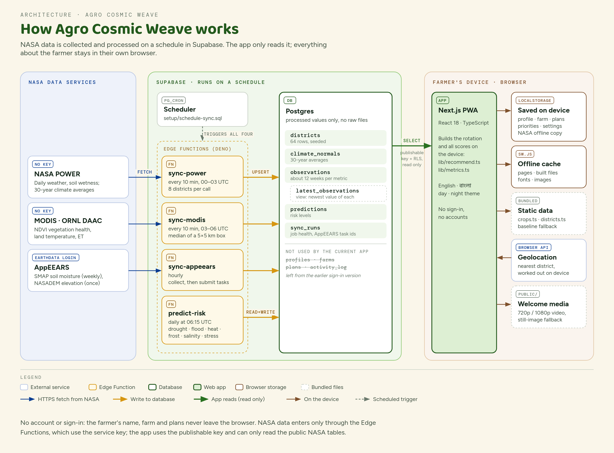
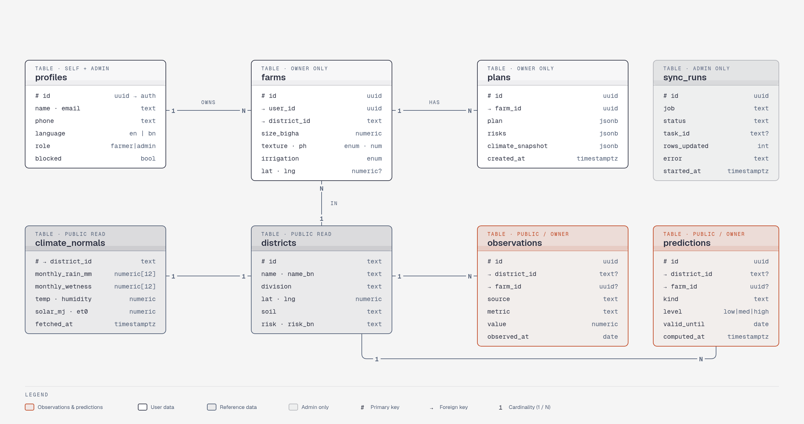

<p align="center">
  
</p>

<h1 align="center">Agro Cosmic Weave</h1>

<p align="center">
  <strong>A climate-adaptive crop rotation and soil health planner for Bangladesh.</strong>
</p>

<p align="center">
  <a href="https://www.spaceappschallenge.org/"></a>
  
</p>

<p align="center">
  
  
  
  
  
  
</p>

<p align="center">
  
  
  
</p>

---

Agro Cosmic Weave helps farmers and agricultural officers pick crop rotations that use less water, build soil health, and hold up better under climate stress. It covers all 64 districts of Bangladesh, uses NASA climate and satellite data (POWER, MODIS, SMAP and NASADEM), and works in both English and Bangla.

Built by **SPIDERX** for the NASA Space Apps Challenge.

---

## Contents

- [What it does](#what-it-does)
- [System architecture](#system-architecture)
- [Quick start](#quick-start)
- [Welcome screen](#welcome-screen)
- [First-time setup](#first-time-setup)
- [Install and offline use](#install-and-offline-use)
- [How the recommendations work](#how-the-recommendations-work)
- [Project structure](#project-structure)
- [Data and saved state](#data-and-saved-state)
- [Backend (Supabase)](#backend-supabase)
- [Limitations](#limitations)
- [Tech stack](#tech-stack)
- [Contributing](#contributing)
- [Acknowledgements](#acknowledgements)

---

## What it does

No account or sign-in is needed. Press **Get Started**, answer three quick setup questions, and the dashboard opens.

The dashboard is split into tabs. They are listed in the side menu, which also has the English/Bangla switch and the day/night theme switch. On phones a bottom bar gives quick access to **Plan**, **What-If**, **NASA** and **Report**, and **More** opens the full menu. The top bar shows the selected district with its soil, yearly rainfall and main risk, a district picker grouped by division, and a shortcut to the dossier.

| Tab | What you can do |
| --- | --- |
| **Crop Rotation Optimizer** | Pick your priorities (save water, improve soil, more income, cattle fodder, lower climate risk). Compare up to four rotation strategies against what you grow now, ranked by how well they fit your priorities. Each strategy shows why it was suggested, its gains and trade-offs, and what to check with your agriculture officer. The evidence behind the advice (NASA POWER, SMAP, MODIS, NASADEM, current risk levels) and the information gaps are listed. |
| **What-If Climate Simulator** | Change rainfall, temperature and irrigation availability with sliders, or pick a quick scenario (severe drought, heatwave, flood year, normal year), and see how both plans hold up. |
| **Soil & Water Analytics** | Compare water use, nitrogen balance, soil score, drought resilience and crop diversity, plus a 3-year soil organic matter projection. |
| **NASA Earth Data** | 30-year NASA POWER averages for the district (monthly rainfall, temperature, humidity, solar radiation, root-zone soil wetness, estimated crop water demand), the last 30 days against normal (rain, hot days, cold nights), a satellite view (MODIS vegetation health and land temperature, SMAP soil moisture, NASADEM elevation) and current risk levels. |
| **Farm & Soil Profile** | Enter farm size (bigha), soil texture, pH, organic matter and irrigation source. Recommendations update immediately. |
| **Farm Action Dossier** | A printable plan with the farm summary, 4-season crop schedule, water and urea savings, soil health score, what to check with your agriculture officer, the evidence and information gaps, and soil management actions. Copy the summary or save it as PDF. |

Everything you enter is saved automatically in your browser, and the app works on phones, tablets and desktops. Animations are reduced to simple fades for people who turn on "reduce motion" in their device settings.

---

## System architecture



*Open [docs/diagrams/supabase-architecture.html](docs/diagrams/supabase-architecture.html) in a browser for a sharper version that follows your light or dark setting.*

The system has three parts:

- **NASA data services.** NASA POWER and MODIS need no key; AppEEARS (SMAP soil moisture, NASADEM elevation) uses a free Earthdata login.
- **Supabase, on a schedule.** `pg_cron` triggers four Edge Functions. `sync-power`, `sync-modis` and `sync-appeears` fetch from NASA and save only processed values to Postgres. `predict-risk` turns the latest observations into risk levels. Only these functions can write, using the service key.
- **The farmer's device.** The Next.js app reads `climate_normals`, `latest_observations` and `predictions` with the publishable key (read only, protected by row-level security). It builds the rotation and all scores on the device. The profile, farm, plans, settings and an offline copy of the NASA data stay in `localStorage`; the service worker caches the app for offline use; the bundled crop and district data are the fallback when NASA data hasn't synced; and location is matched to the nearest district on the device.

There is no sign-in and no account, so nothing about the farmer is sent to the server.

---

## Quick start

**Requirements:** Node.js 18 or later, npm, and a [Supabase](https://supabase.com/) project (the free tier is enough).

1. Install packages:

   ```bash
   npm install
   ```

2. Create `.env.local` in the project root with your Supabase project's URL and publishable (anon) key, from **Project Settings → API**:

   ```bash
   NEXT_PUBLIC_SUPABASE_URL=https://<your-project>.supabase.co
   NEXT_PUBLIC_SUPABASE_PUBLISHABLE_KEY=<publishable-or-anon-key>
   ```

   The app will not start without these. The app only reads public NASA data from Supabase, and the publishable key is safe in the browser; row-level security in the database decides what can be read.

3. Set up the database by applying the migrations (see [Database setup](#database-setup)).

4. Start the app:

   ```bash
   npm run dev
   ```

   Open <http://localhost:3000>.

NASA data appears once the sync functions have run (see [Deploying the NASA sync](#deploying-the-nasa-sync)). Until then the NASA tab and the recommendations fall back to the district baselines in `data/districts.ts`.

| Command | Purpose |
| --- | --- |
| `npm run dev` | Start the development server |
| `npm run build` | Build for production |
| `npm run start` | Serve the production build |
| `npm run lint` | Run Next.js lint checks (see note below) |

> **Note:** ESLint is not set up in this repo yet (no `eslint` dependency or config). The first `npm run lint` will ask you to choose a config and install ESLint.

---

## Welcome screen

Every visit starts on the welcome screen ([components/WelcomeScreen.tsx](components/WelcomeScreen.tsx)):

- **Get Started** (or **Continue** for returning visitors) opens the app. There are no accounts or passwords; a local profile is created on this device.
- **See how it works** shows the three steps: pick your district, add your soil and water, get your crop plan.
- An English/Bangla switch in the corner.
- Links to the **Terms of Service** and **Privacy Policy**, shown in a pop-up ([components/LegalModal.tsx](components/LegalModal.tsx)).
- A looping background video of paddy fields. A 720p file is used by default and a 1080p file on large or high-density screens (`public/login-bg.mp4`, `public/login-bg-1080.mp4`). A still image (`public/login-bg.jpg`) is shown instead on slow connections, with data saver on, or when reduced motion is turned on.

When the app opens it asks the browser for the person's location (only on HTTPS or `localhost`). For a new visitor, the nearest district is selected automatically ([lib/geo.ts](lib/geo.ts)); a returning visitor keeps the district they chose.

---

## First-time setup

On the first visit, a short three-step setup asks for:

1. **District** — already filled in from the person's location if they allowed it. They can pick another from the list (grouped by division, with the district's rainfall and main risk), or tap *Use my location* to try again.
2. **Soil texture** — with plain-language hints (e.g. "sticky when wet, cracks when dry").
3. **Water source and farm size** — irrigation type and farm size in bigha.

It can be skipped, and every value can be changed later in **Farm & Soil Profile** (or the district from the top bar). Setup is shown once per browser.

---

## Install and offline use

Agro Cosmic Weave is a Progressive Web App:

- [app/manifest.ts](app/manifest.ts) provides the web app manifest, so it can be installed to a phone's home screen.
- [public/sw.js](public/sw.js) is a service worker that caches pages, built files, fonts and images, so the app still opens without a connection. It does not touch Supabase requests or the background videos (those stream normally).
- The farm profile and plans are stored in the browser, so they work offline. The app also keeps an offline copy of the last NASA data it loaded for each district, so recommendations still use it without internet.
- The service worker is registered by [components/ServiceWorker.tsx](components/ServiceWorker.tsx), only in production builds (`npm run build && npm run start`). Under `npm run dev` it removes any worker left from an earlier production run, so stale code is never served. To drop old caches after a big change, bump `VERSION` in `public/sw.js`.

---

## How the recommendations work

Recommendations come from simple, readable rules rather than a trained model, so they are easy to check and adjust. All of it lives in [lib/recommend.ts](lib/recommend.ts) and [lib/metrics.ts](lib/metrics.ts).

**1. Reading the conditions** — `assessConditions()`
The app collects evidence from every source it has and flags **drought**, **salinity**, **flood**, **cold**, **heat** and **crop stress** risk. Each fact is kept and shown to the farmer, with the risks it raised.

| Source | Rule (examples) |
| --- | --- |
| District profile | Keywords in the known local hazard (e.g. "saline", "haor", "groundwater") |
| NASA POWER averages | Rainfall under 1,600 mm → drought; mean temperature under 25 °C → cold; 26.7 °C or more → heat |
| NASA POWER, last 30 days | Rain 50% below normal → drought, 60% above → flood; 5+ days at 35 °C → heat; 5+ nights under 10 °C → cold |
| SMAP soil moisture | Root zone under 0.15 m³/m³ → drought; over 0.42 → flood |
| MODIS | Land surface temperature 40 °C or more → heat; NDVI under 0.3 → crop stress |
| NASADEM | Elevation under 5 m → flood |
| Server risk levels | Any medium or high level from `predict-risk` |
| Farm profile | Rain-fed farm → drought |

The app also lists what it cannot see, such as missing satellite data or a farm that still uses the default pH and organic matter values.

**2. Building strategies**

| Strategy | Rotation | Shown when |
| --- | --- | --- |
| **Climate-adaptive** | One crop per season chosen for the risks (rules below) | Always |
| **Small step** | Mustard – Boro – Aman – Mungbean | Always |
| **Income & fodder** | Maize – Lentil – Aman – Mungbean | No flood or salinity risk, and the farm is irrigated |
| **Water & soil saver** | Chickpea/Lentil – Lentil/Chickpea – Aman – Mungbean | No flood or salinity risk |

Strategies with the same crops as one already listed, or as the current practice, are dropped. The climate-adaptive rules:

| Season | Default | Changes when… |
| --- | --- | --- |
| 1 · Winter | Mustard | Wheat in cold, non-saline districts |
| 2 · Winter/Spring | Lentil | Salt-tolerant wheat if saline (and season 1 isn't already wheat); otherwise chickpea if drought or heat without flood. In flood-prone districts lentil stays, because it is harvested before early floods. |
| 3 · Monsoon | Ropa Aman rice | — |
| 4 · Summer | Mungbean | Hybrid maize if there is no drought, salinity or flood risk, tube-well irrigation, and organic matter ≥ 1.5% |

**3. Scoring and ranking**
Each plan is scored for water demand, net nitrogen, soil score (0–100), water stress, yield resilience, crop-family diversity, income and fodder value. Soil texture and irrigation source adjust water demand and supply; in the simulator, the rainfall, temperature and irrigation sliders are applied on top.

Each strategy gets a 0–100 match score: the farmer's chosen priorities count three times as much as the others, and every crop that is a poor fit for the local risks takes off 8 points. Strategies are listed best match first.

This is a screening model for **comparing plans**, not a crop growth model. Treat the numbers as relative, not as yield forecasts.

---

## Project structure

```text
.
├── app/
│   ├── layout.tsx          # HTML shell, metadata, fonts, theme and language set before first paint
│   ├── page.tsx            # Welcome screen → first-time setup → dashboard (with crossfades)
│   ├── manifest.ts         # PWA manifest (name, colours, icons)
│   ├── not-found.tsx
│   └── globals.css
├── components/
│   ├── AppProvider.tsx     # Shared app state (local profile, location, district, farm, plans, NASA data)
│   ├── WelcomeScreen.tsx   # First screen: Get Started, how it works, video background
│   ├── LegalModal.tsx      # Terms of Service and Privacy Policy pop-up
│   ├── Onboarding.tsx      # First-time setup
│   ├── Dashboard.tsx       # Layout and tab switching
│   ├── Sidebar.tsx, TopBar.tsx, BottomNav.tsx
│   ├── CropIcon.tsx        # Drawn crop icons
│   ├── ServiceWorker.tsx   # Registers public/sw.js in production
│   ├── ui.tsx              # Shared cards, buttons, input styles, language switch
│   └── tabs/               # One file per dashboard tab
├── data/
│   ├── crops.ts            # 8 crops: water use, nitrogen, tolerance, income, fodder, Bangla names
│   └── districts.ts        # 64 districts: location, soil, baseline rainfall and temp, risks
├── lib/
│   ├── supabase.ts         # Supabase client
│   ├── climate.ts          # Reads NASA averages, latest observations and risk levels from Supabase
│   ├── recommend.ts        # Evidence, risk detection, strategies, ranking, soil tips
│   ├── metrics.ts          # Plan scoring and soil organic matter projection
│   ├── geo.ts              # Distance and nearest-district lookup for the location feature
│   ├── storage.ts          # localStorage-backed React state
│   ├── motion.ts           # Shared animation settings (Motion)
│   ├── auth.ts             # Initials helper (plus helpers left from the old sign-in)
│   ├── options.ts          # Divisions, soil textures, irrigation types, priorities, default farm
│   ├── i18n.ts             # English / Bangla helpers
│   └── types.ts
├── supabase/
│   ├── migrations/         # Database schema, seed data, access rules
│   ├── functions/          # Edge Functions: sync-power, sync-modis, sync-appeears, predict-risk
│   └── setup/              # schedule-sync.sql (cron jobs for the functions)
├── docs/diagrams/          # Backend architecture and data model diagrams
├── assets/banners/         # README banner images and their HTML sources
├── public/
│   ├── sw.js               # Service worker (offline cache)
│   ├── logo.png, logo-sm.png
│   ├── icon-*.png, apple-touch-icon.png         # App icons
│   └── login-bg.mp4, login-bg-1080.mp4, login-bg.jpg   # Welcome screen background
└── global.d.ts             # Lets TypeScript accept CSS imports
```

The `@/` import alias points to the project root.

---

## Data and saved state

- **Crops** — rice (Boro and Aman), wheat, lentil, chickpea, mustard, maize and mungbean, in [data/crops.ts](data/crops.ts). To add a crop, add an entry to `CROP_DATABASE` (including `incomeScore` and `forageScore`) and it becomes available in the plan editors. Optionally add a drawn icon for it in [components/CropIcon.tsx](components/CropIcon.tsx); without one it shows a plain tile. The recommendations only use the rules above, so a new crop is not suggested until you add it to a strategy.
- **Districts** — all 64 districts in [data/districts.ts](data/districts.ts), with coordinates and baseline climate. The same list is seeded into the `districts` table for the NASA sync.
- **Your data** — there are no accounts. The local profile, farm profile, current and suggested plans, chosen priorities, district, language, theme, selected tab and the offline copy of NASA data are all saved in the browser's `localStorage` under keys starting with `fs-` ([lib/storage.ts](lib/storage.ts)). Nothing about the farmer is sent to a server. To delete it, clear this site's data in the browser. Data does not move between devices or browsers.

---

## Backend (Supabase)

Supabase is used only for NASA data. The app reads district climate averages, the latest observations and risk levels; it never writes to the database.

**How it works:** NASA APIs → Supabase Edge Functions (fetch, filter, process) → Supabase Postgres (only the values the app needs). We never store raw NASA files or responses. The app reads from our database, so it never waits on NASA and keeps working if a NASA service is slow or down.

See [System architecture](#system-architecture) for the diagram.

### NASA data sources

| API | What we take | Key | How often | Level | Stored as |
|---|---|---|---|---|---|
| [NASA POWER](https://power.larc.nasa.gov/api/temporal/daily/point) | Daily rain, min/max temperature, solar radiation, surface and root-zone wetness; 30-year monthly climatology | None | Daily; climatology yearly | District | `climate_normals`, `observations` |
| [MODIS Web Service (ORNL DAAC)](https://modis.ornl.gov/rst/api/v1/) | NDVI vegetation health (MOD13Q1, 16-day), land surface temperature (MOD11A2, 8-day), evapotranspiration (MOD16A2, 8-day) | None | Weekly | District | `observations` |
| [AppEEARS](https://appeears.earthdatacloud.nasa.gov/api/) | SMAP L4 root-zone and surface soil moisture, NASADEM elevation | Earthdata Login (free) | SMAP weekly; elevation once | District | `observations` |

Notes:
- **AppEEARS is asynchronous.** A request becomes a task that can take minutes to hours, so each hourly call of `sync-appeears` first collects finished tasks, then starts new ones when due. One task covers all 64 districts, and the results come back as CSV.
- **Recent NASA data arrives a few days late**, and some values come back as `-999` (missing). The functions skip these.

### Edge Functions

| Function | Runs | What it does |
|---|---|---|
| [`sync-power`](supabase/functions/sync-power/index.ts) | Every 10 min, 00:00–02:59 UTC; each district daily, climatology yearly | Fetches 8 districts per call, drops missing values, computes monthly rain, ET₀, 30-day rain against normal, hot days and cold nights |
| [`sync-modis`](supabase/functions/sync-modis/index.ts) | Every 10 min, 03:00–05:59 UTC; each district weekly | Median NDVI, land surface temperature and evapotranspiration in a 5 × 5 km box around each district point |
| [`sync-appeears`](supabase/functions/sync-appeears/index.ts) | Hourly | Collects finished AppEEARS tasks, then submits the weekly SMAP task and the one-time elevation task; task IDs live in `sync_runs` |
| [`predict-risk`](supabase/functions/predict-risk/index.ts) | Daily at 06:15 UTC | Turns the latest observations into drought, flood, heat, frost, salinity and crop-stress levels (simple, documented rules) and writes `predictions` |

Long jobs process districts in batches so each run stays inside the Edge Function time limit. Progress is recorded in `sync_runs`.

### What we store

| Store | Don't store |
|---|---|
| Processed values, one row per metric per district or farm | Raw NASA JSON, CSV bundles or data files |
| The latest value plus about 12 weeks of history | Satellite images and map tiles |
| Climate averages per district (64 rows) | Data for places no farm is in |
| Latest risk predictions per district | Old predictions after they expire |
| | Farmers' names, farms or plans (these stay in the browser) |

NASA-derived data stays at roughly 10,000 rows (64 districts × about 12 metrics × 12 weeks), no matter how much NASA data exists.

### Tables



*Interactive version: [docs/diagrams/supabase-data-model.html](docs/diagrams/supabase-data-model.html)*

| Table | Main columns | Purpose |
|---|---|---|
| `profiles` | id (→ auth.users), name, email, phone, language (en/bn), role (farmer / admin), blocked, provider, last_sign_in_at, sign_in_count | User details and roles; a trigger creates the row at sign-up |
| `farms` | id, user_id, district_id, area, irrigation, soil, lat, lng | Farm profile (one per account) |
| `plans` | id, farm_id, plan (jsonb), risks (jsonb), climate_snapshot (jsonb), created_at | Saved rotation plans |
| `districts` | id (e.g. `dhaka`), name, name_bn, division, lat, lng, soil, baseline rainfall and temp, risk, risk_bn | Seeded from `data/districts.ts` |
| `climate_normals` | district_id, monthly_rain_mm[12], monthly_wetness[12], temp_mean, humidity, solar_mj, et0_mm_day, fetched_at | 30-year NASA POWER averages |
| `observations` | id, district_id or farm_id, source (power / modis / smap / nasadem), metric, value, observed_at | Processed measurements from every NASA source; the `latest_observations` view gives the newest value of each |
| `predictions` | id, district_id or farm_id, kind, level, valid_until, computed_at | Risk levels from `predict-risk` |
| `sync_runs` | id, job, status, task_id, rows_updated, error, started_at | Sync health and AppEEARS tasks |
| `activity_log` | id, actor_id, action, target, created_at | Admin activity feed |

The app itself reads only `climate_normals`, `latest_observations` and `predictions`. The `profiles`, `farms`, `plans` and `activity_log` tables come from the earlier version with sign-in and an admin panel; they are still in the migrations but the current app does not use them.

### Access rules (RLS)

- `districts`, `climate_normals`, and district-level `observations` and `predictions`: anyone can read; only Edge Functions (service key) can write.
- `farms` and `plans`: only the owner (`user_id = auth.uid()`); admins can read all.
- `profiles`: users can edit their own name, phone and language only. Role, blocked status and sign-in details can only be changed by an admin or the system. (Unused by the current app.)
- `activity_log` and `sync_runs`: admins only.

### Database setup

The schema lives in [supabase/migrations/](supabase/migrations/). Apply them in this order, either by pasting each into the Supabase SQL editor or with `npx supabase db push` after `npx supabase link`:

1. `20261108120000_init_schema.sql` — tables, access rules, triggers
2. `20261108120100_seed_districts.sql` — the 64 districts from `data/districts.ts`
3. `20261108130000_auth_tracking.sql` — sign-in details, activity log rules, blocking (from the earlier sign-in version)
4. `20261109090000_farm_sync_and_satellite.sql` — one farm per account, the `latest_observations` view, keeping elevation

### Deploying the NASA sync

The four functions are in [supabase/functions/](supabase/functions/). Each is a single file.

1. Set the secrets (pick a long random `CRON_SECRET`; the Earthdata login is your free [NASA Earthdata](https://urs.earthdata.nasa.gov/) account):
   `npx supabase secrets set CRON_SECRET=<secret> EARTHDATA_USERNAME=<user> EARTHDATA_PASSWORD=<password> --project-ref <ref>`
2. Deploy each with JWT checks off (the functions check `CRON_SECRET` themselves):
   `npx supabase functions deploy sync-power --no-verify-jwt --project-ref <ref>`, then the same for `sync-modis`, `sync-appeears` and `predict-risk`. You can also paste each file into the dashboard's function editor and turn off "Enforce JWT verification".
3. Fill in your project URL and the same `CRON_SECRET` in [supabase/setup/schedule-sync.sql](supabase/setup/schedule-sync.sql) and run it in the SQL editor. It is safe to run again. Don't commit your real values.

The first fill takes a day or two of scheduled runs: NASA POWER finishes the first morning, MODIS over two mornings, and AppEEARS tasks take a few hours. To start sooner, run `select public.call_edge_function('sync-power');` a few times. Check progress with:

```sql
select job, status, rows_updated, error, started_at from sync_runs order by started_at desc;
```

### Secrets

| Secret | Used by | Where it lives |
|---|---|---|
| `NEXT_PUBLIC_SUPABASE_URL`, `NEXT_PUBLIC_SUPABASE_PUBLISHABLE_KEY` | The web app | `.env.local` (git-ignored) |
| `CRON_SECRET` | All four Edge Functions and `schedule-sync.sql` | Supabase function secrets |
| `EARTHDATA_USERNAME`, `EARTHDATA_PASSWORD` | `sync-appeears` | Supabase function secrets |
| `SUPABASE_SERVICE_ROLE_KEY` | Edge Functions only | Provided by Supabase inside functions |

POWER and MODIS need no key. Never put the service role key or Earthdata password in a `NEXT_PUBLIC_` variable or commit them to git.

---

## Limitations

- NASA data is per district (around the district's centre point), not per farm.
- Salinity risk comes only from the district profile; no live salinity data is connected.
- The rotation is built in the browser so it works offline; only the risk levels come from the server.
- There are no accounts, so a farm and plan saved on one phone or browser are not available on another.
- There is no in-app button to delete saved data; clear the site's data in the browser instead.
- Free Supabase projects pause after about a week without visits, and scheduled syncs do not run while paused.
- The scoring model is a simplified comparison tool and has not been validated against field data. Income and fodder scores are relative values, not live market prices.

---

## Tech stack

- [Next.js 14](https://nextjs.org/) (App Router) and React 18
- TypeScript
- Tailwind CSS
- [Motion](https://motion.dev/) for animations (respects reduced-motion settings)
- [Supabase](https://supabase.com/) (Postgres, Edge Functions, cron)
- Inter and Noto Sans Bengali fonts via `next/font`
- [lucide-react](https://lucide.dev/) icons
- NASA [POWER](https://power.larc.nasa.gov/), [MODIS via ORNL DAAC](https://modis.ornl.gov/) and [AppEEARS](https://appeears.earthdatacloud.nasa.gov/) (SMAP, NASADEM)

---

## Contributing

1. Create a branch from `main`.
2. Run `npm run lint` and `npm run build` before opening a pull request.
3. Add every user-facing string in both languages, using `t('English', 'বাংলা')` from `useApp()`.
4. Put database changes in a new file in `supabase/migrations/`; don't edit migrations that have already been applied.

---

## License

No license has been chosen yet, so all rights are reserved by the repository owner. Add a `LICENSE` file to allow reuse.

## Acknowledgements

- [NASA Space Apps Challenge](https://www.spaceappschallenge.org/)
- NASA Langley Research Center [POWER Project](https://power.larc.nasa.gov/) for climate data
- [ORNL DAAC](https://modis.ornl.gov/) for the MODIS web service
- NASA [AppEEARS](https://appeears.earthdatacloud.nasa.gov/) for SMAP and NASADEM data
